# RyannKim327 Portfolio


[](https://wakatime.com/badge/user/61954829-dd88-47de-8b67-7d673663ea1c/project/da79e6a7-f448-49fd-8ce7-d643023e18b8)


[](https://github.com/RyannKim327/ryannkim327.github.io/actions/workflows/gh-pages.yml)

> **A redefined, retro-modern personal portfolio showcasing the work, skills, and projects of Ryann Kim M. Sesgundo, built with React 19, Tailwind CSS 4, Vite 8, and TypeScript — complete with an admin CMS and the Krysanne AI assistant.**

---

## Table of Contents

- [🚀 Live Demo](#-live-demo)
- [✨ Features](#-features)
- [🛠️ Tech Stack](#-tech-stack)
  - [Frontend](#frontend)
  - [Backend](#backend)
  - [Tooling & Libraries](#tooling--libraries)
- [🧭 Application Routes](#-application-routes)
- [📁 Project Structure](#-project-structure)
- [🚀 Getting Started](#-getting-started)
  - [Prerequisites](#prerequisites)
  - [Installation](#installation)
  - [Available Scripts](#available-scripts)
- [🎨 Design & Aesthetics](#-design--aesthetics)
- [🔗 Backend Integration](#-backend-integration)
- [🔐 Admin CMS](#-admin-cms)
- [🤖 Krysanne AI Assistant](#-krysanne-ai-assistant)
- [📝 About the Developer](#-about-the-developer)
- [🤝 Contributing](#-contributing)
- [📄 License](#-license)
- [🙏 Acknowledgments](#-acknowledgments)
- [🔧 Technical Details](#-technical-details)

---

## 🚀 Live Demo

Visit the live portfolio at: [ryannkim327.is-a.dev](https://ryannkim327.is-a.dev)

---

## ✨ Features

- ⚛️ **Modern React 19 Foundation** - Re-engineered using React 19 and the React Compiler for automatic memoization and optimal rendering performance.
- 👾 **Retro-Modern Visual Identity** - Distinctive typography with the Silkscreen pixel font, bold 3D isometric text depth effects, and offset card borders.
- 🎨 **Tailwind CSS 4 System** - Powered by Tailwind CSS v4 `@theme inline` design tokens with system-aware dark and light themes (`prefers-color-scheme`).
- ⚡ **Lightning Fast Tooling** - Supercharged by Vite 8, Rolldown, and Oxlint for high-speed builds and near-instant linting.
- 📜 **Parallax & Scroll Interactions** - Fixed typography background (`Name` widget) combined with smooth vertical scrolling content layers, animated scroll prompts, and section-aware state.
- 🧭 **Dedicated Content Routes** - Full pages for blogs (with pagination and query-param viewing), projects (with category filters), certificates, and downloads.
- 💼 **Experience Timeline** - Chronological career history with sticky category headings and styled terminal-style bullet points.
- 🏆 **Certificates Showcase** - Interactive certificates gallery with dynamic asset retrieval, category indicators, modal previews, and external verification links.
- 🗂️ **Dynamic Project Showcase** - Randomly shuffled project highlights featuring smooth grayscale-to-color hover transitions and direct asset retrieval.
- 📰 **Blog Highlights** - Preview cards displaying recent blog write-ups, with a custom Markdown renderer and excerpt generator.
- 🤖 **Krysanne AI Assistant** - A developer-focused chatbot with a reactive robot-head avatar, section-aware context, and live portfolio data (blogs, projects, certificates, experiences, WakaTime).
- 🐾 **Interactive Mascot** - A cursor-tracking character built with `page-mascot` that reacts to pointer movement and clicks.
- 🔐 **Admin CMS** - Password-protected admin panel for managing contacts, blogs, certificates, projects, experiences, downloads, and file uploads.
- ✍️ **Markdown Editor** - Toolbar-assisted editor with write, preview, and split modes, powered by a custom Markdown-to-HTML renderer.
- 📬 **Interactive Footer & Contact** - Direct message form alongside quick-access social links and a dynamic copyright year.
- 🔔 **Toast Notifications** - Consistent success and error feedback across the admin workflows via `react-toastify`.
- 📱 **Fully Responsive** - Designed from the ground up to provide seamless viewing across mobile, tablet, and ultra-wide displays.

---

## 🛠️ Tech Stack

### Frontend

- **React 19.3** - Modern component-based UI framework
- **TypeScript 7.0** - End-to-end static type safety
- **Tailwind CSS 4.3** - Modern CSS framework with native `@theme inline` variables
- **React Router 8.5** - Client-side routing via `HashRouter`
- **React Compiler** - Automated optimization and memoization via `babel-plugin-react-compiler`
- **Lucide React** - Consistent icon set used across the portfolio and admin panel
- **React Toastify** - Toast notifications for admin actions
- **Page Mascot & Robot Heads** - Cursor-tracking mascot and animated chatbot avatar

### Backend

- **Go REST API** - High-performance backend handling dynamic content, certificates, projects, blogs, experiences, downloads, contact messages, feedback, and AI chat
- **Repository**: [portfolio-backend](https://github.com/RyannKim327/portfolio-backend)

### Tooling & Libraries

- **Vite 8.3** - Next-generation development server and production bundler
- **Oxlint 1.92** - High-performance Rust-based JavaScript / TypeScript linter
- **Axios 1.21** & **tough-cookie** / **axios-cookiejar-support** - Robust HTTP client with cookie management
- **Silkscreen Font** - Retro arcade pixel typography

---

## 🧭 Application Routes

The app uses `HashRouter`, so every route is prefixed with `#` in the URL.

| Route | Description |
| --- | --- |
| `/` | Portfolio home with hero, about, experiences, certificates, projects, blogs, feedback, and footer sections |
| `/blogs` | Full blog browser with pagination (`?p=`) and individual post viewing (`?v=`) |
| `/projects` | Project gallery with category filters and modal details |
| `/certificates` | Certificate gallery with modal previews and external links |
| `/download/:id` | Shareable download page resolved by slug; missing or unknown IDs show 403/404 states |
| `/admin` | Password-protected admin shell (login required) |
| `/admin/blog` | Create a blog post with the Markdown editor |
| `/admin/edit-blog/:id` | Blog editing route (editor scaffold) |
| `/admin/certificates` | Add certificates |
| `/admin/project` | Add projects |
| `/admin/experiences` | Create, edit, and reorder experience records |
| `/admin/download` | Add download entries |
| `/admin/upload` | Upload files through the backend |

---

## 📁 Project Structure

```mermaid
%% Generated by https://gitdiagram.com/ryannkim327/ryannkim327.github.io
flowchart TD

subgraph group_public["Public Portfolio"]
  node_router["Route Entry<br/>[main.tsx]"]
  node_portfolio["Portfolio Home<br/>[app.tsx]"]
  node_showcase["Profile Sections"]
  node_blogbrowse["Blog Browser<br/>[blogs.tsx]"]
  node_publiccontent["Content Views"]
  node_feedback["Feedback Form<br/>[feedback.tsx]"]
  node_chatbot["Portfolio Chatbot<br/>[chatbot.tsx]"]
end

subgraph group_admin["Administration"]
  node_adminshell["Admin Shell<br/>[admin.tsx]"]
  node_login["Admin Login<br/>[login.tsx]"]
  node_dashboard["Contact Dashboard<br/>[index.tsx]"]
  node_contentadmin["Content Management"]
  node_markdowneditor["Markdown Editor"]
end

subgraph group_shared["Shared Services"]
  node_api["API Client<br/>[api.ts]"]
  node_storage[("Browser Storage<br/>[storage.ts]")]
  node_markdown["Markdown Rendering<br/>[markdown.ts]"]
  node_interfaces["Content Types<br/>[interface.ts]"]
end

subgraph group_external["External Services"]
  node_backend["Portfolio REST API"]
end

node_visitor(("Visitor"))

node_visitor -->|"opens"| node_router
node_router -->|"routes to"| node_portfolio
node_router -->|"routes to"| node_blogbrowse
node_router -->|"routes to"| node_publiccontent
node_router -->|"routes to"| node_adminshell
node_portfolio -->|"renders"| node_showcase
node_portfolio -->|"loads content"| node_api
node_portfolio -->|"renders"| node_chatbot
node_portfolio -->|"renders"| node_feedback
node_blogbrowse -->|"fetches blogs"| node_api
node_publiccontent -->|"fetches content"| node_api
node_chatbot -->|"sends chat"| node_api
node_showcase -->|"loads content"| node_api
node_adminshell -->|"renders"| node_login
node_adminshell -->|"uses session state"| node_storage
node_router -->|"routes to"| node_dashboard
node_router -->|"routes to"| node_contentadmin
node_dashboard -->|"loads contacts"| node_api
node_contentadmin -->|"manages content"| node_api
node_contentadmin -->|"uses editor"| node_markdowneditor
node_markdowneditor -->|"renders preview"| node_markdown
node_blogbrowse -->|"renders blog text"| node_markdown
node_api -->|"uses session token"| node_storage
node_api -->|"sends REST requests"| node_backend
node_showcase -->|"uses content types"| node_interfaces
node_api -->|"types responses"| node_interfaces

click node_router "https://github.com/ryannkim327/ryannkim327.github.io/blob/main/src/main.tsx"
click node_portfolio "https://github.com/ryannkim327/ryannkim327.github.io/blob/main/src/app.tsx"
click node_showcase "https://github.com/ryannkim327/ryannkim327.github.io/tree/main/src/components/index"
click node_blogbrowse "https://github.com/ryannkim327/ryannkim327.github.io/blob/main/src/routes/users/blogs.tsx"
click node_publiccontent "https://github.com/ryannkim327/ryannkim327.github.io/tree/main/src/routes/users"
click node_feedback "https://github.com/ryannkim327/ryannkim327.github.io/blob/main/src/components/index/feedback.tsx"
click node_chatbot "https://github.com/ryannkim327/ryannkim327.github.io/blob/main/src/components/widgets/chatbot.tsx"
click node_adminshell "https://github.com/ryannkim327/ryannkim327.github.io/blob/main/src/admin.tsx"
click node_login "https://github.com/ryannkim327/ryannkim327.github.io/blob/main/src/components/admin/login.tsx"
click node_dashboard "https://github.com/ryannkim327/ryannkim327.github.io/blob/main/src/routes/admin/index.tsx"
click node_contentadmin "https://github.com/ryannkim327/ryannkim327.github.io/tree/main/src/routes/admin"
click node_markdowneditor "https://github.com/ryannkim327/ryannkim327.github.io/blob/main/src/components/widgets/markdown-editor.tsx"
click node_api "https://github.com/ryannkim327/ryannkim327.github.io/blob/main/src/lib/api.ts"
click node_storage "https://github.com/ryannkim327/ryannkim327.github.io/blob/main/src/lib/storage.ts"
click node_markdown "https://github.com/ryannkim327/ryannkim327.github.io/blob/main/src/lib/markdown.ts"
click node_interfaces "https://github.com/ryannkim327/ryannkim327.github.io/blob/main/src/interface.ts"

classDef toneNeutral fill:#f8fafc,stroke:#334155,stroke-width:1.5px,color:#0f172a
classDef toneBlue fill:#dbeafe,stroke:#2563eb,stroke-width:1.5px,color:#172554
classDef toneAmber fill:#fef3c7,stroke:#d97706,stroke-width:1.5px,color:#78350f
classDef toneMint fill:#dcfce7,stroke:#16a34a,stroke-width:1.5px,color:#14532d
classDef toneRose fill:#ffe4e6,stroke:#e11d48,stroke-width:1.5px,color:#881337
classDef toneIndigo fill:#e0e7ff,stroke:#4f46e5,stroke-width:1.5px,color:#312e81
classDef toneTeal fill:#ccfbf1,stroke:#0f766e,stroke-width:1.5px,color:#134e4a
class node_router,node_portfolio,node_showcase,node_blogbrowse,node_publiccontent,node_feedback,node_chatbot toneBlue
class node_adminshell,node_login,node_dashboard,node_contentadmin,node_markdowneditor toneAmber
class node_api,node_storage,node_markdown,node_interfaces toneMint
class node_backend toneRose
class node_visitor toneIndigo
```



```
portfolio-redefine/
├── public/
│   ├── assets/
│   │   └── silkscreen/          # Silkscreen TTF font assets & license
│   ├── mascots/                 # Mascot sprite sheets & variants
│   ├── favicon.svg              # Site favicon
│   ├── icons.svg                # Icon sprites
│   └── logo.png                 # Site logo
├── src/
│   ├── __tests__/
│   │   └── test.ts              # Test scaffold
│   ├── assets/
│   │   ├── styles/
│   │   │   ├── dark.css         # Dark theme color variables
│   │   │   └── light.css        # Light theme color variables
│   │   ├── dark.png             # Developer portrait asset
│   │   ├── hero.png             # Hero graphic asset
│   │   ├── react.svg
│   │   └── vite.svg
│   ├── components/
│   │   ├── admin/
│   │   │   └── login.tsx        # Admin password login & session check
│   │   ├── index/               # Public page section components
│   │   │   ├── about.tsx        # Bio, mascot & overview section
│   │   │   ├── blogs.tsx        # Recent blog posts grid
│   │   │   ├── certificates.tsx # Certificates showcase
│   │   │   ├── experiences.tsx  # Work & experience timeline
│   │   │   ├── feedback.tsx     # User feedback cards
│   │   │   ├── footer.tsx       # Contact form & social footer
│   │   │   ├── hero.tsx         # Hero banner & scroll indicator
│   │   │   └── projects.tsx     # Random project showcase
│   │   └── widgets/             # Reusable UI widgets
│   │       ├── chatbot.tsx      # Krysanne AI chat widget
│   │       ├── logo.tsx         # Decorative logo widget
│   │       ├── markdown-editor.tsx # Markdown editor with live preview
│   │       ├── markdown.tsx     # Markdown rendering components
│   │       ├── modal.tsx        # Reusable modal overlay
│   │       ├── name.tsx         # 3D fixed background typography widget
│   │       ├── sections.tsx     # Section indicator widget
│   │       └── title.tsx        # Sticky section title widget
│   ├── lib/
│   │   ├── api.ts               # Axios client, admin helpers & asset retrieval
│   │   ├── markdown.ts          # Custom Markdown parser & excerpt helpers
│   │   └── storage.ts           # localStorage / sessionStorage helpers
│   ├── routes/
│   │   ├── admin/               # Admin CMS routes
│   │   │   ├── blog.tsx         # Create blog posts
│   │   │   ├── certificates.tsx # Add certificates
│   │   │   ├── download.tsx     # Add download entries
│   │   │   ├── edit-blog.tsx    # Blog editor route
│   │   │   ├── experiences.tsx  # Manage experiences
│   │   │   ├── index.tsx        # Contact dashboard
│   │   │   ├── project.tsx      # Add projects
│   │   │   └── upload.tsx       # File upload form
│   │   └── users/               # Public content routes
│   │       ├── blogs.tsx        # Blog browser & reader
│   │       ├── certificates.tsx # Certificate gallery
│   │       ├── download.tsx     # Download detail page
│   │       └── projects.tsx     # Project gallery & filters
│   ├── admin.tsx                # Admin shell, navigation & auth guard
│   ├── app.tsx                  # Portfolio home & parallel data loader
│   ├── index.css                # Global Tailwind CSS styles & animations
│   ├── interface.ts             # TypeScript interfaces and types
│   └── main.tsx                 # Router entry point
├── .github/
│   └── workflows/
│       └── gh-pages.yml         # GitHub Pages deployment workflow
├── .oxlintrc.json               # Oxlint configuration
├── index.html                   # HTML entry point & metadata
├── package.json                 # Project dependencies & npm scripts
├── tsconfig.json                # TypeScript root configuration
├── tsconfig.app.json            # App TypeScript configuration
├── tsconfig.node.json           # Node/tooling TypeScript configuration
└── vite.config.ts               # Vite configuration with React, Tailwind & Babel plugins
```

---

## 🚀 Getting Started

### Prerequisites

- **Node.js** (v20+ recommended)
- **npm** (v10+ recommended)

### Installation

1. Clone the repository:
   ```bash
   git clone https://github.com/RyannKim327/ryannkim327.github.io.git
   ```
2. Navigate to the project directory:
   ```bash
   cd ryannkim327.github.io
   ```
3. Install dependencies:
   ```bash
   npm install
   ```

### Available Scripts

- `npm run dev` - Launch the Vite development server with HMR
- `npm run build` - Type-check with TypeScript and bundle for production
- `npm run lint` - Run Oxlint for ultra-fast codebase linting
- `npm run preview` - Preview the production build locally
- `npm test` - Run the Jest test command (currently a placeholder scaffold)
- `npm run deploy` - Build and publish `dist/` to the `redefine` branch with the custom domain
- `npm run predeploy` - Automatically runs `npm run build` before `deploy`

---

## 🎨 Design & Aesthetics

- **Retro-Modern Typography**: Utilizes the **Silkscreen** pixel font paired with monospace elements to evoke classic computing aesthetics.
- **3D Isometric Depth**: Custom CSS text shadow layers (`._3d`, `._3d-card`, `._3d-chat`) create a bold visual hierarchy for the background nameplate, cards, and chat bubbles.
- **Dynamic Offset Cards**: Bespoke offset shadow borders (`.card`) using customized theme colors for subtle retro framing.
- **System-Aware Themes**: Seamlessly switches between light and dark modes according to `prefers-color-scheme` with balanced high-contrast accents.
- **Scroll-Aware Context**: Scroll tracking detects the active section and feeds it to the mascot and chatbot.
- **Fluid Layout**: Fully responsive CSS Grid and Flexbox layouts designed for all viewport breakpoints.
- **Custom Scrollbars & Animations**: Styled scrollbars, bouncing loaders, and animated scroll prompts complete the retro-modern feel.

---

## 🔗 Backend Integration

The client communicates with the custom backend API hosted at `https://portfolio-backend-pi-nine.vercel.app`. The base URL and local toggle live in [`src/lib/api.ts`](./src/lib/api.ts).

- **Public Endpoints**: `blog`, `certs`, `dev`, `experiences`, `projects`, `wakatime`, `feedback`, `download`, and `ai/chat`.
- **Admin Endpoints**: `contact`, `blog/submit`, `certs/submit`, `project/submit`, `download/submit`, `experiences` (PUT), `upload/submit`, and `admin` login.
- **Authentication**: Admin requests send the stored admin code via the `X-API-Key` header. Login stores the code and expiration in `sessionStorage`, and the session is re-checked every 30 minutes.
- **HTTP Client**: Axios is wrapped with `tough-cookie` and `axios-cookiejar-support` for cookie-aware requests.
- **Admin Helpers**: `adminGet`, `adminPost`, `adminPostMultipart`, and `adminPut` provide authenticated access to protected resources.
- **Media Retrieval**: Centralized asset resolution helper (`retrieval`) for dynamically served server images.

---

## 🔐 Admin CMS

The admin area at `/admin` is protected by a password login and a time-limited session.

- **Contact Dashboard** - Read messages submitted through the portfolio contact form.
- **Blog** - Create posts with title, tags, media, and Markdown content.
- **Certificates** - Add source, URL, category, and verification link.
- **Projects** - Add a name, image, categories, link, and description.
- **Experiences** - Create, edit, and reorder timeline entries.
- **Downloads** - Create shareable download entries with Markdown descriptions.
- **Upload** - Send files to the backend and receive a reusable file code.
- **Notifications** - Toast notifications confirm every create, update, or upload action.

---

## 🤖 Krysanne AI Assistant

Krysanne is the portfolio's built-in chatbot and virtual guide.

- **Developer-Centric Persona** - Answers questions about Ryann Kim using a structured developer profile.
- **Live Portfolio Context** - Injects blogs, projects, certificates, experiences, and WakaTime activity into each request.
- **Section Awareness** - Knows which portfolio section the visitor is currently viewing and prioritizes that context.
- **Reactive Avatar** - The robot-head avatar reflects `idle`, `happy`, `thinking`, and `listening` states.
- **Resilient Messaging** - Automatically retries failed requests after a short delay.

---

## 📝 About the Developer

**Ryann Kim M. Sesgundo** is an Information Technology graduate and Full-Stack Developer specializing in modern web applications, automation scripting, and AI integration.

- **GitHub**: [@RyannKim327](https://github.com/RyannKim327)
- **Website**: [ryannkim327.is-a.dev](https://ryannkim327.is-a.dev)

---

## 🤝 Contributing

Contributions, issues, and feature requests are welcome!

1. Fork the repository
2. Create your branch (`git checkout -b feat/YourFeature`)
3. Commit your changes (`git commit -m 'feat: add some feature'`)
4. Push to the branch (`git push origin feat/YourFeature`)
5. Open a Pull Request

---

## 📄 License

This project is licensed under the **Creative Commons Attribution-NonCommercial 4.0 International License (CC BY-NC 4.0)**.

Copyright (c) 2024-2026 **Ryann Kim Sesgundo**

### Terms & Permissions:
- **Attribution** — You must give appropriate credit (Author: Ryann Kim Sesgundo, Source: [ryannkim327.github.io](https://github.com/ryannkim327/ryannkim327.github.io)), provide a link to the license, and indicate if changes were made.
- **NonCommercial** — You may not use the material for commercial purposes, including selling the code/derivatives, commercial products/services, monetization via advertising/subscriptions, or commercial consulting/development services.

For the complete terms, refer to [LICENSE.md](./LICENSE.md) or visit the [Creative Commons Legal Code](https://creativecommons.org/licenses/by-nc/4.0/legalcode).

For commercial licensing inquiries, please contact: [weryses19@gmail.com](mailto:weryses19@gmail.com)

---

## 🙏 Acknowledgments

- [React](https://react.dev/) for the modern UI library
- [Vite](https://vite.dev/) for the lightning-fast build tooling
- [Tailwind CSS](https://tailwindcss.com/) for versatile styling
- [React Router](https://reactrouter.com/) for client-side routing
- [Oxlint](https://oxc.rs/) for rapid code linting
- [Lucide](https://lucide.dev/) for the icon set
- [React Toastify](https://fkhadra.github.io/react-toastify/) for notifications
- [Page Mascot](https://www.npmjs.com/package/page-mascot) and [Robot Heads](https://www.npmjs.com/package/robot-heads) for the interactive characters
- [Silkscreen Font](https://kottke.org/plus/type/silkscreen/) by Jason Kottke

---

## 🔧 Technical Details

- **React 19 & React Compiler**: Employs React 19 features with `@vitejs/plugin-react` and `@rolldown/plugin-babel` + `babel-plugin-react-compiler` for streamlined reactivity.
- **Hash-Based Routing**: Uses `HashRouter` so all public and admin routes work on static GitHub Pages hosting without server rewrites.
- **Parallel Data Fetching**: The home page uses `Promise.all` with React 19's `use()` to gather blogs, certificates, developer data, experiences, projects, and WakaTime metrics together.
- **Custom Markdown Pipeline**: `src/lib/markdown.ts` implements escaping, inline formatting, headings, lists, blockquotes, code fences, links, highlights, and excerpt generation without an external parser.
- **Session-Based Admin Auth**: Admin credentials and expiration are kept in `sessionStorage`; protected requests attach the admin code as `X-API-Key`.
- **Tailwind CSS v4 `@theme inline`**: Native CSS variable binding backed by `light.css` and `dark.css` theme files, eliminating legacy JavaScript configuration overhead.
- **Path Aliases**: `@/` resolves to `src/` through the Vite config for cleaner imports.
- **Oxlint Integration**: Fast, low-latency linting across all TypeScript/TSX source files.
- **CI/CD Deployment**: The `gh-pages.yml` workflow builds on pushes to `main` and publishes to the `redefine` branch with the `ryannkim327.is-a.dev` custom domain.
